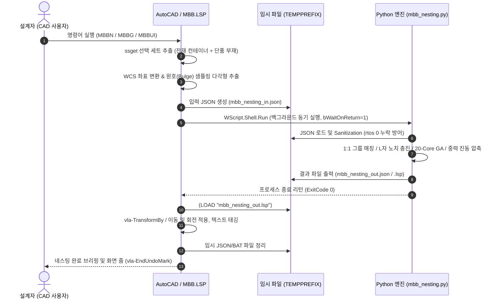

# MBB 시스템 아키텍처 (System Architecture)

> **문서 버전**: v5.22  
> **최종 갱신 일시**: 2026-10-28 15:30:00  
> **인코딩 표준**: UTF-8

---

## 1. 전체 아키텍처 개요 (End-to-End Pipeline)

MBB 시스템은 **AutoCAD AutoLISP(프론트엔드)**와 **Python 백엔드(고성능 연산 오프로드 엔진)** 간의 무중단 파일 기반 파이프라인으로 설계되었습니다.



---

## 2. 인터페이스 데이터 규격 (JSON Data Contract)

### 2.1 입력 JSON (`mbb_nesting_in.json`)
AutoLISP `c:MBBN`에서 생성되어 Python 엔진으로 전달되는 표준 입력 스키마입니다.

```json
{
  "containers": [
    {
      "id": 0,
      "type": "polygon",
      "outer_bbox": [476482.76, -141012.10, 477522.76, -139202.10],
      "outer_polygon": [
        [476482.76, -141012.10],
        [477522.76, -141012.10],
        [477522.76, -139202.10],
        [476482.76, -139202.10]
      ],
      "area": 1818350.0
    }
  ],
  "parts": [
    {
      "id": 0,
      "w": 1008.0,
      "h": 1218.0,
      "orig_min_x": 476482.76,
      "orig_min_y": -141012.10,
      "polygon": [
        [0.0, 0.0],
        [1008.0, 0.0],
        [1008.0, 715.0],
        [365.0, 715.0],
        [365.0, 1218.0],
        [0.0, 1218.0]
      ],
      "actual_area": 896244.0,
      "container_id": 0
    }
  ],
  "rules": {
    "margin": 2.0,
    "gap": 3.0
  }
}
```

### 2.2 출력 LISP (`mbb_nesting_out.lsp`)
Python 엔진이 계산을 마친 후 즉각 AutoLISP 메모리에 로드될 수 있도록 반환하는 직접 실행 파일입니다.

```lisp
;;; MBBN v5.7 Nesting Plan
(setq MBB_TOTAL_YIELD 96.59)
(setq MBB_PART_YIELD 100.00)
(setq MBB_PLACED_COUNT 21)
(setq MBB_UNPLACED_COUNT 0)
(setq MBB_NESTING_PLAN '(
  ;; (part_id container_id gx gy cur_w cur_h rot parent_part_id)
  (0 0 476482.7639 -141012.1048 1008.0000 1218.0000 0 -1)
  (1 0 476482.7639 -139791.1048 269.5000 437.0000 0 -1)
  ...
))
(setq MBB_UNPLACED_PLAN '(
  ;; 미배치 부재 목록 (외곽 자동 배치)
))
(setq MBB_NESTING_STATUS "SUCCESS")
```

---

## 3. 핵심 엔지니어링 가드레일 (Key Engineering Guardrails)

1. **AutoCAD `rtos` 선행 0 누락 방어 (Sanitization)**:
   - AutoCAD의 `rtos` 함수는 1 미만의 실수 출력 시 선행 0을 생략(예: `.3297`)하여 표준 JSON 파서에서 `JSONDecodeError`를 유발합니다.
   - Python 진입부에서 `raw_json.replace(', .', ', 0.').replace('[.', '[0.').replace('-.', '-0.').replace(': .', ': 0.')` 위생 처리를 강제하여 100% 무결성 파싱을 보장합니다.
2. **단일 Undo 트랜잭션 보장**:
   - AutoLISP 측에서 `vla-StartUndoMark`와 `vla-EndUndoMark`로 전 과정을 단일 트랜잭션으로 묶어, 오류 발생 또는 사용자가 `Ctrl+Z` 실행 시 단 1회로 원본 도면 상태로 완벽 복원됩니다.
3. **ANSI (CP949) 무손실 보존**:
   - AutoLISP 소스 및 입출력 LISP 파일은 한글 주석 깨짐 방지를 위해 `CP949` 규격으로 직렬화됩니다.
